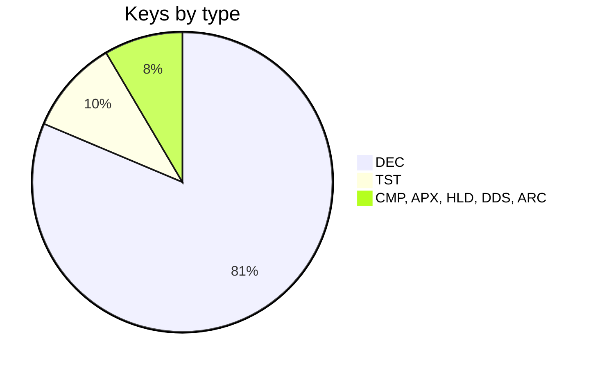

# 01_Summary: reference framework (`CMP-00001`)

Purpose: the state of the documentation framework, one page · owner reference framework ([`CMP-00001`](https://github.com/racetracks/wow-lfg-mesh_scratch/tree/main/documents/reference-framework)) · last updated session intelligent-darwin-5smmqv, prompt 02 · status live · related `16_Registries/REGISTRY.md`, `12_User_Guides/12_02_Documentation_Rules.md`

## Contents
- [State](#state)
- [Keys](#keys)
- [Changelog](#changelog)

## State
| Item | Where |
| --- | --- |
| Rules (the one home) | `12_User_Guides/12_02_Documentation_Rules.md` |
| Registry | `16_Registries/REGISTRY.md` (fresh from `00001`, [`DEC-00048`](https://github.com/racetracks/wow-lfg-mesh_scratch/blob/main/documents/reference-framework/00_Decisions.md#dec-00048)) |
| Tools | `08_Operations/registry-tool/` (`refkey.py`, `link_keys.py`), `08_Operations/structure-builder/` |
| Tests | `15_Tests.md` |
| Waiting on the author | `00_Decisions.md#1-waiting-on-the-author` |

## Keys

| Type | Keys |
| --- | --- |
| DEC | 48 |
| TST | 6 |
| CMP, APX, HLD, DDS, ARC | 5 |

## Changelog
| Date | Reference | Change | Reason | Context |
| --- | --- | --- | --- | --- |
| 2026-11-23 | this file | created | the author: fresh start with the PSS rules | [prompt 02](https://github.com/racetracks/wow-lfg-mesh_scratch/blob/main/temp/2026/11/23/06-11-56-Mon-intelligent-darwin-5smmqv/prompts/02.md); before: new |
