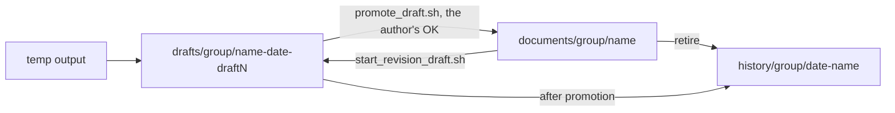

# 06_Architecture: reference framework (`ARC-00001`)

Purpose: the folders and the flow of a document from temp to history · owner reference framework ([`CMP-00001`](https://github.com/racetracks/wow-lfg-mesh_scratch/tree/main/documents/reference-framework)) · last updated session intelligent-darwin-5smmqv, prompt 02 · status live · related `12_User_Guides/12_02_Documentation_Rules.md`

## Contents
- [Folders](#folders)
- [Flow](#flow)
- [Changelog](#changelog)

## Folders
| Folder | Holds | Rule |
| --- | --- | --- |
| `temp/` | session memory | [`DEC-00011`](https://github.com/racetracks/wow-lfg-mesh_scratch/blob/main/documents/reference-framework/12_User_Guides/12_02_Documentation_Rules.md#dec-00011), [`DEC-00004`](https://github.com/racetracks/wow-lfg-mesh_scratch/blob/main/documents/reference-framework/12_User_Guides/12_02_Documentation_Rules.md#dec-00004) |
| `drafts/` | drafts, mirroring `documents/` | [`DEC-00015`](https://github.com/racetracks/wow-lfg-mesh_scratch/blob/main/documents/reference-framework/12_User_Guides/12_02_Documentation_Rules.md#dec-00015), [`DEC-00029`](https://github.com/racetracks/wow-lfg-mesh_scratch/blob/main/documents/reference-framework/12_User_Guides/12_02_Documentation_Rules.md#dec-00029) |
| `documents/` | approved documentation | [`DEC-00017`](https://github.com/racetracks/wow-lfg-mesh_scratch/blob/main/documents/reference-framework/12_User_Guides/12_02_Documentation_Rules.md#dec-00017) |
| `history/` | retired documents and promoted drafts | [`DEC-00030`](https://github.com/racetracks/wow-lfg-mesh_scratch/blob/main/documents/reference-framework/12_User_Guides/12_02_Documentation_Rules.md#dec-00030) |
| `docs/` | hosted packs and zips | scratch `CLAUDE.md` rule 6 |

## Flow

## Changelog
| Date | Reference | Change | Reason | Context |
| --- | --- | --- | --- | --- |
| 2026-11-23 | this file | created | the author: fresh start with the PSS rules | [prompt 02](https://github.com/racetracks/wow-lfg-mesh_scratch/blob/main/temp/2026/11/23/06-11-56-Mon-intelligent-darwin-5smmqv/prompts/02.md); before: new |
