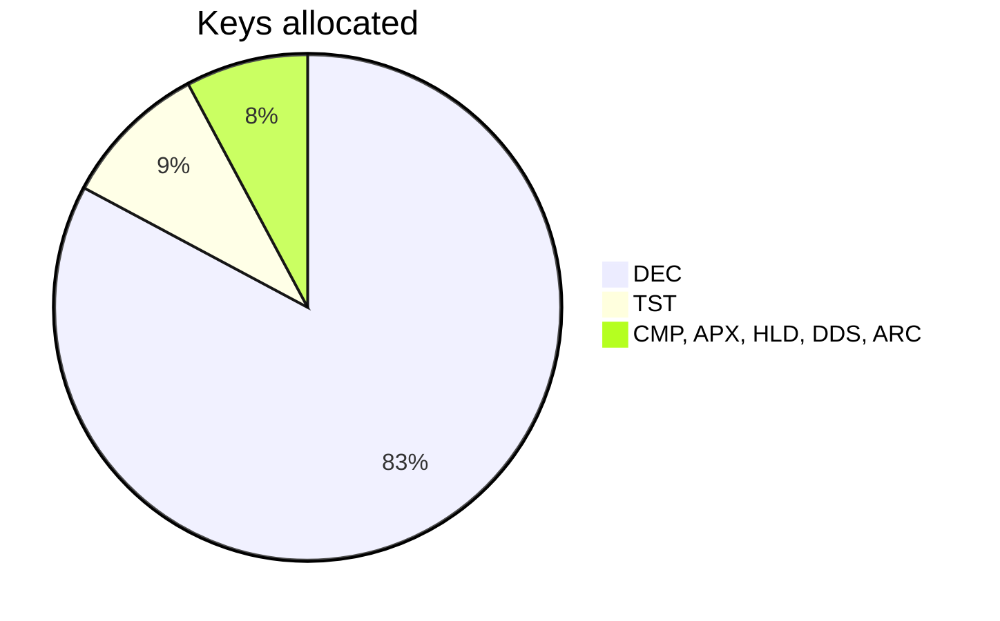

# Framework: the PSS reference framework ported to wow-lfg-mesh

Purpose: what prompt 02 delivered and what waits on the author · owner this session · status delivered · related [prompt 02](../prompts/02.md), [setup](../setup/README.md)

## Contents
- [Done](#done)
- [Not ported](#not-ported)
- [Decisions for you](#decisions-for-you)
- [Decisions made (this session's context)](#decisions-made-this-sessions-context)
- [Recent prompts](#recent-prompts)
- [References](#references)

## Done
| What | Keys | Where |
| --- | --- | --- |
| Rules home: interaction, documentation, framework, records, naming | [`DEC-00001`](https://github.com/racetracks/wow-lfg-mesh_scratch/blob/main/documents/reference-framework/12_User_Guides/12_02_Documentation_Rules.md#dec-00001) to [`DEC-00047`](https://github.com/racetracks/wow-lfg-mesh_scratch/blob/main/documents/reference-framework/12_User_Guides/12_02_Documentation_Rules.md#dec-00047) | [12_02_Documentation_Rules.md](https://github.com/racetracks/wow-lfg-mesh_scratch/blob/main/documents/reference-framework/12_User_Guides/12_02_Documentation_Rules.md) |
| Fresh registry (the reference index) | [`DEC-00048`](https://github.com/racetracks/wow-lfg-mesh_scratch/blob/main/documents/reference-framework/00_Decisions.md#dec-00048) | [REGISTRY.md](https://github.com/racetracks/wow-lfg-mesh_scratch/blob/main/documents/reference-framework/16_Registries/REGISTRY.md) |
| Agent-pack decisions re-keyed | [`DEC-00049`](https://github.com/racetracks/wow-lfg-mesh_scratch/blob/main/documents/reference-framework/00_Decisions.md#dec-00049) to [`DEC-00053`](https://github.com/racetracks/wow-lfg-mesh_scratch/blob/main/documents/reference-framework/00_Decisions.md#dec-00053) | [00_Decisions.md](https://github.com/racetracks/wow-lfg-mesh_scratch/blob/main/documents/reference-framework/00_Decisions.md) |
| Tools: `refkey.py`, `link_keys.py`, 13 structure scripts | - | [08_Operations/](https://github.com/racetracks/wow-lfg-mesh_scratch/tree/main/documents/reference-framework/08_Operations) |
| Framework root set (built by script) | [`CMP-00001`](https://github.com/racetracks/wow-lfg-mesh_scratch/tree/main/documents/reference-framework), [`APX-00001`](https://github.com/racetracks/wow-lfg-mesh_scratch/blob/main/documents/reference-framework/00_Appendix.md), [`HLD-00001`](https://github.com/racetracks/wow-lfg-mesh_scratch/blob/main/documents/reference-framework/04_High_Level_Design.md), [`DDS-00001`](https://github.com/racetracks/wow-lfg-mesh_scratch/blob/main/documents/reference-framework/05_Detailed_Design.md), [`ARC-00001`](https://github.com/racetracks/wow-lfg-mesh_scratch/blob/main/documents/reference-framework/06_Architecture.md) | [reference-framework/](https://github.com/racetracks/wow-lfg-mesh_scratch/tree/main/documents/reference-framework) |
| Tests run on a copy, all pass | [`TST-00001`](https://github.com/racetracks/wow-lfg-mesh_scratch/blob/main/documents/reference-framework/15_Tests.md#tst-00001) to [`TST-00006`](https://github.com/racetracks/wow-lfg-mesh_scratch/blob/main/documents/reference-framework/15_Tests.md#tst-00006) | [15_Tests.md](https://github.com/racetracks/wow-lfg-mesh_scratch/blob/main/documents/reference-framework/15_Tests.md) |
| PSS to mesh key mapping | - | [00_References.md](https://github.com/racetracks/wow-lfg-mesh_scratch/blob/main/documents/reference-framework/00_References.md) |
| `documents/`, `drafts/`, `history/` groups | [`DEC-00017`](https://github.com/racetracks/wow-lfg-mesh_scratch/blob/main/documents/reference-framework/12_User_Guides/12_02_Documentation_Rules.md#dec-00017), [`DEC-00029`](https://github.com/racetracks/wow-lfg-mesh_scratch/blob/main/documents/reference-framework/12_User_Guides/12_02_Documentation_Rules.md#dec-00029) | [documents/](https://github.com/racetracks/wow-lfg-mesh_scratch/tree/main/documents) |
| LFGMesh documentation folder (built by script) | [`CMP-00002`](https://github.com/racetracks/wow-lfg-mesh_scratch/tree/main/documents/addons/LFGMesh), [`DEC-00054`](https://github.com/racetracks/wow-lfg-mesh_scratch/blob/main/documents/reference-framework/00_Decisions.md#dec-00054), [`DEC-00055`](https://github.com/racetracks/wow-lfg-mesh_scratch/blob/main/documents/reference-framework/00_Decisions.md#dec-00055) | [documents/addons/LFGMesh/](https://github.com/racetracks/wow-lfg-mesh_scratch/tree/main/documents/addons/LFGMesh) |
| Both CLAUDE.md files on the new keys, linked copies rendered | [`DEC-00008`](https://github.com/racetracks/wow-lfg-mesh_scratch/blob/main/documents/reference-framework/12_User_Guides/12_02_Documentation_Rules.md#dec-00008) | [scratch CLAUDE.linked.md](https://github.com/racetracks/wow-lfg-mesh_scratch/blob/main/CLAUDE.linked.md), [addon CLAUDE.linked.md](https://github.com/racetracks/wow-lfg-mesh/blob/claude/intelligent-darwin-5smmqv/docs/linked/CLAUDE.linked.md) |

| Type | Keys |
| --- | --- |
| DEC | 53 |
| TST | 6 |
| CMP, APX, HLD, DDS, ARC | 5 |

## Not ported
| What | Why |
| --- | --- |
| PSS decisions history, legacy series, old `docs/components/` layout | fresh start ([`DEC-00048`](https://github.com/racetracks/wow-lfg-mesh_scratch/blob/main/documents/reference-framework/00_Decisions.md#dec-00048)) |
| PSS code map and its generator | nothing to map yet (open decision below) |
| `move_framework.sh` | one-off PSS migration |

## Decisions for you
None.

Also waiting on you (not decisions): merge [PR 1](https://github.com/racetracks/wow-lfg-mesh/pull/1).

## Decisions made (this session's context)
| Key | Decision | Date | Source |
| --- | --- | --- | --- |
| [`DEC-00048`](https://github.com/racetracks/wow-lfg-mesh_scratch/blob/main/documents/reference-framework/00_Decisions.md#dec-00048) | fresh registry, other projects' keys never quoted as keys | 2026-11-23 | [prompt 02](../prompts/02.md) |
| [`DEC-00001`](https://github.com/racetracks/wow-lfg-mesh_scratch/blob/main/documents/reference-framework/12_User_Guides/12_02_Documentation_Rules.md#dec-00001) to [`DEC-00047`](https://github.com/racetracks/wow-lfg-mesh_scratch/blob/main/documents/reference-framework/12_User_Guides/12_02_Documentation_Rules.md#dec-00047), [`DEC-00049`](https://github.com/racetracks/wow-lfg-mesh_scratch/blob/main/documents/reference-framework/00_Decisions.md#dec-00049) to [`DEC-00053`](https://github.com/racetracks/wow-lfg-mesh_scratch/blob/main/documents/reference-framework/00_Decisions.md#dec-00053) | PSS rules ported under new keys | 2026-11-23 | [prompt 02](../prompts/02.md) |

## Recent prompts
| # | Prompt | Answer | Output |
| --- | --- | --- | --- |
| [01][p1] | apply PSS CLAUDE.md, baseline, budgets, NEXT.md | done, on the branch | [setup][o1] |
| [02][p2] | port reference index, document rules, naming; fresh start | done | [framework][o2] |
| [03][p3] | yes; recommendations; purpose | scratch on main, PR 1 opened, LFGMesh folder built | [summary][o3] |

## References
| Reference | Title | Link |
| --- | --- | --- |
| [`CMP-00001`](https://github.com/racetracks/wow-lfg-mesh_scratch/tree/main/documents/reference-framework) | Reference framework | [Readme.md](https://github.com/racetracks/wow-lfg-mesh_scratch/blob/main/documents/reference-framework/Readme.md) |
| REGISTRY.md | the reference index | [REGISTRY.md](https://github.com/racetracks/wow-lfg-mesh_scratch/blob/main/documents/reference-framework/16_Registries/REGISTRY.md) |
| 12_02 | the rules home | [12_02_Documentation_Rules.md](https://github.com/racetracks/wow-lfg-mesh_scratch/blob/main/documents/reference-framework/12_User_Guides/12_02_Documentation_Rules.md) |
| addon CLAUDE.md | the addon repo's startup file | [CLAUDE.md](https://github.com/racetracks/wow-lfg-mesh/blob/claude/intelligent-darwin-5smmqv/CLAUDE.md) |

[p1]: ../prompts/01.md
[p2]: ../prompts/02.md
[o1]: ../setup/README.md
[o2]: README.md
[p3]: ../prompts/03.md
[o3]: ../../../../../../summary/wow-lfg-mesh-2026-11-23-06-45.md
